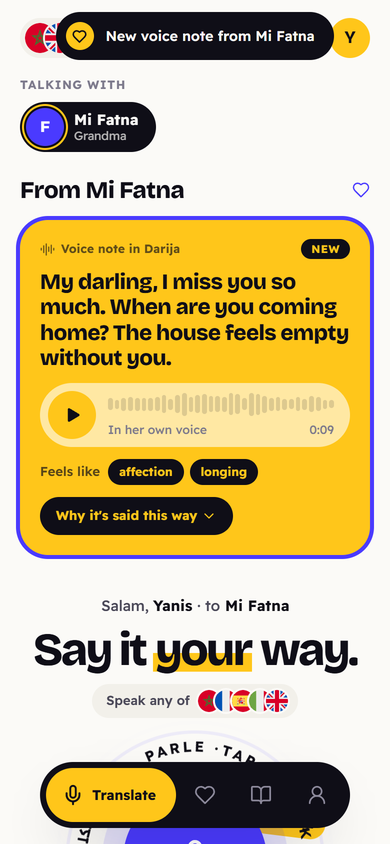
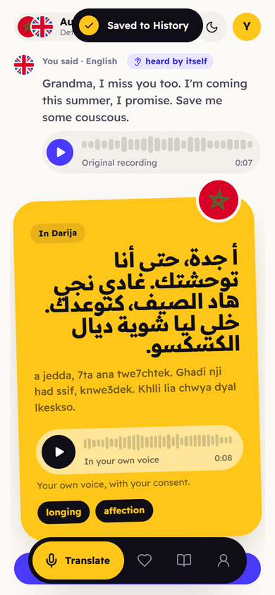
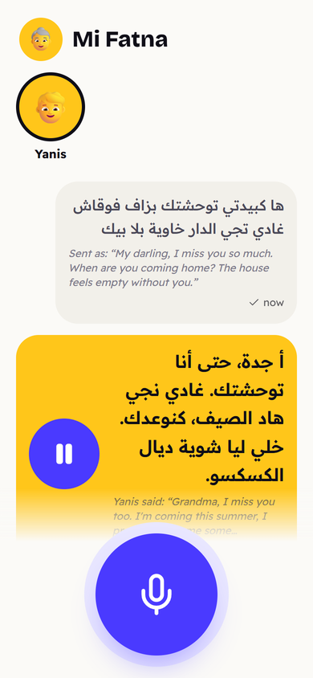

# Kebdti (كبدتي): keep the love in translation

**Track:** Languages · **Team:** Zayd Zaari (solo)

A grandmother in Morocco sends a voice note in Darija. Her grandson in France hears what she *meant*, in English, **in her own voice**. He answers in his language, and she hears it in Darija, **in his voice**.

- **Demo video (1:20):** https://youtu.be/fjIF3dts178
- **Try it live:** https://kebdti2.51-170-131-7.sslip.io
  - Tap **Skip** to open Yanis's phone. Open **/grandma** for Mi Fatna's phone.
- **Starting point:** our own idea (4.4.4)

| Her note arrives | His answer | Grandma's phone |
|---|---|---|
|  |  |  |

## The problem

Millions of Moroccan grandparents speak only Darija. Their grandchildren grew up in France, Spain, Italy or the UK and only understand a little of it. Word-for-word translators keep the words and lose the love: *"A kebdti"* means "my darling", but a normal translator says **"my liver"**.

## What we built

**In:** a voice note (or typed message) in Darija or one of 7 family languages: English, French, Spanish, Italian, Dutch, German or Standard Arabic.

**Out:**
- what the sender **meant**, in the other person's language
- how it feels (affection, longing…)
- a short note on *why it's said this way*
- the whole thing spoken back **in the sender's own cloned voice**

**How a family uses it:**
- **Grandma's phone** has one big button and big play buttons, so she doesn't need to read anything.
- **The grandchild** doesn't pick a language: Kebdti hears which one he speaks.
- **Setting up your own voice** takes one 15–30 second recording.

## What we added

Our own idea, our own data and our own question: *does machine translation lose the love in a grandmother's words?*

- **A knowledge base of elder Darija:** endearments, blessings and proverbs, written by us, a Darija speaker.
- **Held-out test sets** of grandparent messages, never shown to the model while we tuned it, including a fresh per-language set written after the prompt was frozen.
- **Real voice notes from our own grandmother, used with her consent:**
  - to clone her voice
  - to test speech recognition on an elderly speaker

## How it works

**Data:**
- **Knowledge base:** in [`backend/eval/prompts_v4.py`](backend/eval/prompts_v4.py).
- **Development sets:** 66 messages ([`backend/eval/*_phrases.json`](backend/eval)).
- **Three held-out test sets:** 41, 31 and 32 messages ([`final_phrases.json`](backend/eval/final_phrases.json), [`final_test_v4.json`](backend/eval/final_test_v4.json), [`round5_test.json`](backend/eval/round5_test.json)). Each set was written *before* testing and only added to the prompt afterwards. Every test result below comes from a set the prompt had not yet seen.
- **A fourth, fresh set for the per-language test:** 20 messages. It was written after the app's prompt was frozen and leak-checked against it ([`fresh_lang_leakcheck.py`](backend/eval/fresh_lang_leakcheck.py)).
- **Grandmother's voice notes:** 16, cleaned and transcribed. They are private and **not** in this repo.

**Model (pipeline, [`backend/app/pipeline.py`](backend/app/pipeline.py)):**
1. **Speech recognition:** Gemini, with auto-detect of all 8 languages. A grandparent's phone is always treated as Darija, because Darija and Standard Arabic share a script. It refuses silence instead of guessing.
2. **Translation of the meaning:** GPT-6 Luna, with our Kebdti prompt (knowledge base, "faithfulness contract", the family's own words), returning JSON.
   - A second check rewrites any non-Moroccan Arabic words.
3. **Voice in the sender's own voice:**
   - Fish Audio for Darija, ElevenLabs for the other languages.
   - Every Darija voice note is **listened back** by speech recognition. If words are blurred, a second take is made and the clearer one is kept.
4. **The app:** a Next.js web app ([`frontend/`](frontend)) with a FastAPI backend ([`backend/`](backend)). The family conversation is shared between phones.

**Baseline:** the same model (GPT-6 Luna) with a plain "translate this" prompt. This is what "just ask a general AI" gives you.

## Results

**In one line:** on fresh messages in 7 languages, the baseline fully understood **91/140** and Kebdti **115/140**. It fell into word-for-word traps **15 times instead of 40**.

**Translation, on earlier held-out sets** (English output, judged blind by a different model, GPT-6.1 Terra):

| Test set | Measure | Baseline (plain prompt) | Kebdti |
|---|---|---|---|
| **v4 set:** 31 messages, 27 with expressions it had never seen | Fully understood | 18/31 | **25/31** |
| | Expressions it had never seen, understood | 15/27 | **21/27** |
| | Fell into a literal trap ("my liver") | 4/12 | **2/12** |
| | Wrong or confusing | 2 | **1** |
| | Sounds natural (1–3) | 2.65 | **2.87** |
| | Neutral messages kept neutral (no added "darling") | — | 3/3 |
| **Round 5 set:** 32 messages, rare proverbs, 3 that imitate noisy speech recognition | Fully understood | 17/31 | **21/31** |
| | Wrong | 3 | **1** |
| | Noisy speech handled | 3/3 | 3/3 |
| **Final set:** 41 proverbs and everyday expressions | Fully understood | 23/41 | **30/41** |
| | Literal traps | 4 | **1** |

**Side by side** (Darija → English, held-out):

| Grandma says | Correct meaning | Baseline | Kebdti |
|---|---|---|---|
| طاحت الصمعة علقو الحجام | They blamed the wrong person | "The minaret collapsed, and they hanged the barber." | "When something goes wrong, they look for a scapegoat." |
| الكلمة الزوينة كتخرج الحنش من غارو | A kind word can win over anyone | "A kind word draws the snake out of its den." | "You catch more flies with honey than with vinegar." |
| عواشرك مبروكة أوليدي، الله يعاودها عليك | Happy Eid, my boy, many more | "May your festive days be blessed, my son…" | "Happy Eid, my son. May God let you celebrate it again." |
| نتا وخوك بحال الظفر واللحم | You and your brother are inseparable | "You and your brother are like nail and flesh…" | "You and your brother are so close—don't let anything come between you." |
| وجهك ولا صفر فالتصويرة | You look pale in the photo | "Your face looks all yellow in the photo." | "You look pale in the picture." |
| أكبيدتي، توحشتك بزاف… | My darling, I miss you so much… | word for word: "My liver, I missed you a lot…" | "My darling, I miss you so much. When are you coming?" |

**By language, on 20 fresh messages** written after the app's prompt was frozen and leak-checked against it ([`fresh_lang_test.json`](backend/eval/fresh_lang_test.json), [`lang_report.md`](backend/eval/results/lang_report.md)). Same model for both systems; judged blind in each language:

| Language | Fully understood: baseline → Kebdti | Literal traps (of 17): baseline → Kebdti | Sounds natural (1–3) | Her cloned voice: words heard back | Into Darija: pure Moroccan Darija |
|---|---|---|---|---|---|
| English | 11 → **16** /20 | 7 → **2** | 2.50 → 2.80 | 99% (20 notes) | 5/5 |
| French | 12 → **15** /20 | 6 → **1** | 2.45 → 2.85 | 99% (20 notes) | 5/5 |
| Spanish | 13 → **19** /20 | 5 → **0** | 2.65 → 3.00 | 99% (20 notes) | 5/5 |
| Italian | 12 → **17** /20 | 6 → **2** | 2.60 → 2.80 | 99% (20 notes) | 5/5 |
| Dutch | 13 → **18** /20 | 6 → **2** | 2.50 → 2.75 | 99% (20 notes) | 5/5 |
| German | 14 → **15** /20 | 6 → **3** | 2.35 → 2.85 | 100% (20 notes) | 5/5 |
| Standard Arabic | **16** → 15 /20 | **4** → 5 | 2.65 → 2.75 | 95% (20 notes) | 5/5 |
| **All seven** | **91 → 115 /140** | **40 → 15 /119** | | | 35/35 |

**Kebdti helps most where the gap between cultures is biggest:**
- **Spanish, Dutch, Italian and English** gain the most.
- **German** gains a little.
- **Standard Arabic gains nothing:** "يا كبدي" is a real endearment in Arabic too, so a plain translation already keeps the warmth. Here Kebdti's main value is the Moroccan voice and the "why it's said this way" note, not the wording.

The Darija voice (her clone speaking Darija) was harder: 62% of words heard back before our fixes, about 98% after the pause and listen-back fixes.

**Voices:**
- Grandmother's voice: a short pause after the pet name made the opening words heard right 8/8 times (vs 6/8 before).
- Grandchild's own voice: 99% clear (vs 94% before tuning).
- Mixing languages in the set-up recording made voices robotic: 79% of words kept, vs 91% for one clean recording. So the app asks for one 15–30 s recording.

**Whole system:** 46 end-to-end checks on the app pass ([`backend/eval/check_az.py`](backend/eval/check_az.py)). They cover:
- both directions and all 8 languages
- language auto-detection
- unsupported languages refused clearly (Portuguese)
- silence and 0.1 s recordings returned as "unclear", never invented

**Where it fails, and why we think so:**
- **"إمتى نفرح بيك"** came out as "When will you make me happy?" instead of "When will I see you married?". The model doesn't know this idiom.
- **"حتى زين ما خطاتو لولا"** (nobody is perfect) was missed in 6 of the 7 languages (only the German version got it). In Italian the model even read "لولا" as a name, "Lola".
- **"وجهك ولا صفر"** (you look pale) still came out as "yellow face" in French and Italian, and the regional word **"فازگ"** (wet hair) became "head uncovered".
- **Rare proverbs keep their image** ("one hand can't clap"), with the meaning only in the note. Once, for an unknown proverb, the model **invented** a confident wrong one ("Who dares, wins"). We added a rule: never invent; say "Kebdti isn't sure, ask what she meant".
- **Darija voices are harder than European ones:** Darija has no standard spelling and few training voices. That is why every Darija voice note is listened back.
- **It is slow for a phone call:** about 10–15 seconds per message. That's fine for voice notes, which are asynchronous.
- **Honest limits:**
  - The meaning was judged by an AI, plus our own checks as a Darija speaker, not by a panel.
  - Gold meanings were written by us, with an AI assistant.
  - Our test sets are small (31–41 messages) and mostly from one region (near Taounate).

## What we'd do next

1. Have a panel of Darija-speaking grandparents and grandchildren rate meaning and voice, per language, and compare with the AI judge.
2. Add other regions' Darija (Jebli, Hassaniya, Souss). Then test with real Darija-speaking families instead of designed demo voices, using the same held-out method.

## Ethics

- Every voice is used only with that person's permission. Recording the 15–30 s set-up *is* the yes, and it can be deleted any time.
- Grandma's voice notes are private and not published.
- The video's story scenes are AI-generated and labeled as dramatization. The demo voices in the video are designed voices, not real people.

## Sources

**Models and APIs:**
- [Gemini](https://ai.google.dev): speech recognition
- [GPT-6 Luna / GPT-6.1 Terra](https://openai.com): translation and blind judging, through the Straitly and ZenMux API gateways
- [Fish Audio](https://fish.audio): Darija voice cloning
- [ElevenLabs](https://elevenlabs.io): other languages' voices, and the designed demo voices

**Code:**
- [Next.js](https://nextjs.org), [React](https://react.dev) and [Framer Motion](https://www.framer.com/motion/)
- [FastAPI](https://fastapi.tiangolo.com) and [Uvicorn](https://github.com/encode/uvicorn)
- [FFmpeg](https://ffmpeg.org)
- [Playwright](https://playwright.dev): end-to-end tests
- [circle-flags](https://github.com/HatScripts/circle-flags) (MIT)
- [Bricolage Grotesque](https://fonts.google.com/specimen/Bricolage+Grotesque) and [Readex Pro](https://fonts.google.com/specimen/Readex+Pro) fonts

**Proverbs used to build test messages:**
- mwnlifestyle.com, "Exploring the Moroccan idioms and proverbs"
- arabamerica.com, "Proverbs in Moroccan Arabic that don't make much sense when translated into English"

**AI tools we used while building** (we understand and can explain every part):
- [Claude Code](https://claude.com/claude-code) and [OpenAI Codex](https://openai.com/codex): coding assistants
- [ChatGPT](https://chatgpt.com): images for the video
- [Google Flow](https://labs.google/flow): the dramatized video scenes

## Run it yourself

```bash
# backend (Python 3.11)
cd backend
pip install -r requirements.txt
cp .env.example .env    # add your own API keys
python -m uvicorn app.server:app --port 8000

# frontend (Node 20+)
cd frontend
npm ci
KEBDTI_PIPELINE_URL=http://127.0.0.1:8000 npm run dev
```

Open http://localhost:3000 (grandchild) and http://localhost:3000/grandma (grandparent).

**Tests:**
- `npm test` in `frontend`
- `python backend/eval/check_az.py` (needs the app running)
- `python frontend/scripts/e2e_live.py` (two phones)

**Repo map:**
- `frontend/`: the app
- `backend/app/`: the pipeline and API
- `backend/eval/`: test sets, benchmark scripts and every result: `results/*_review.md` for summaries, `results/raw/` for every output
